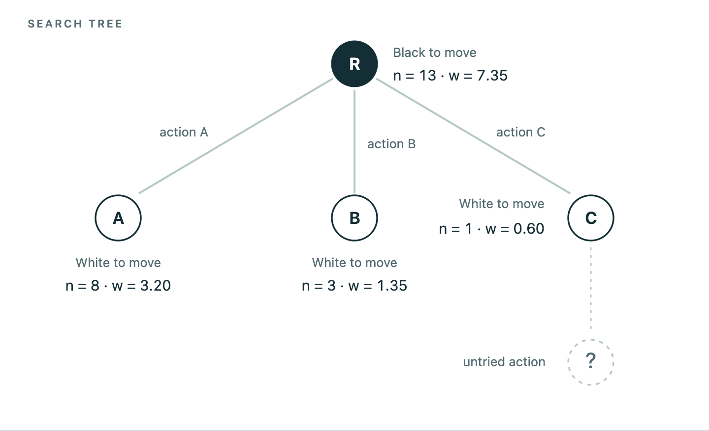
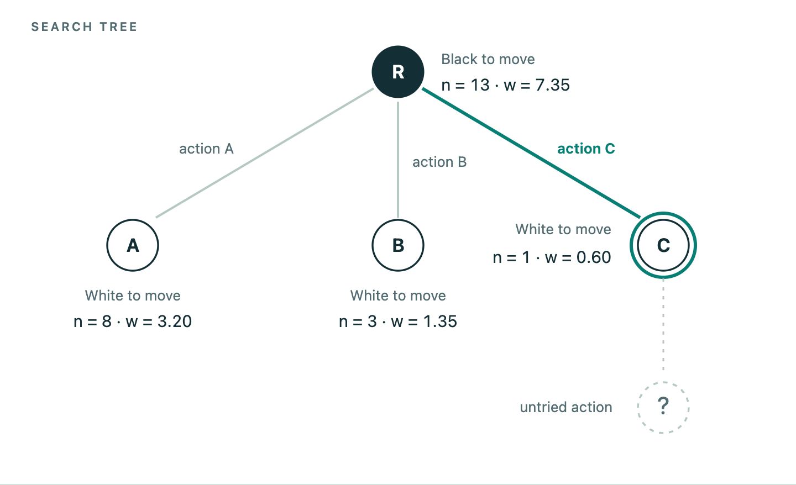
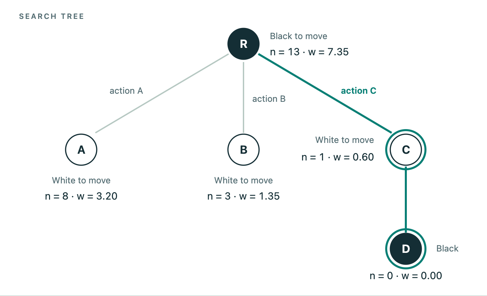
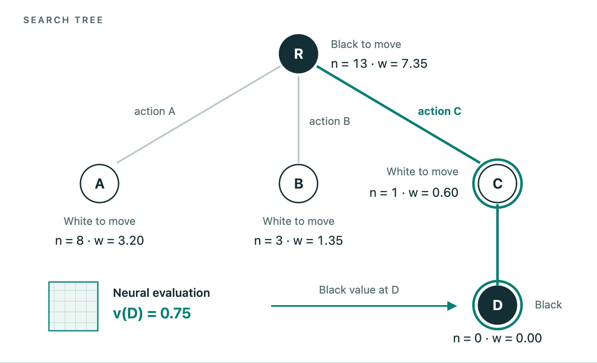
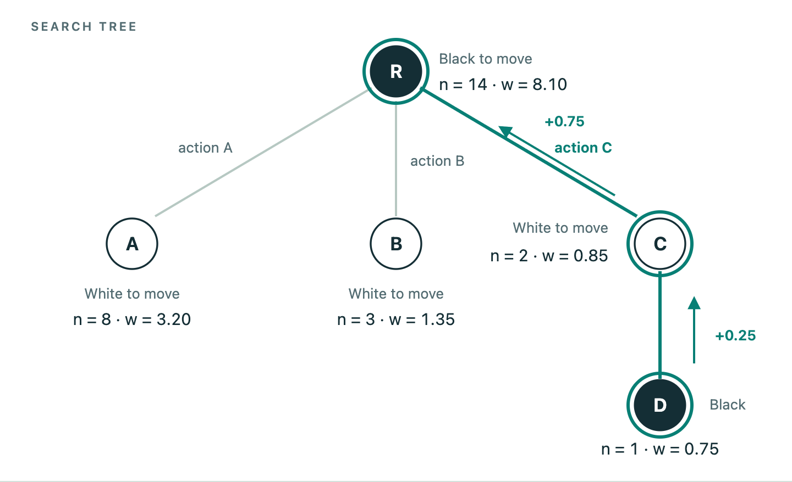
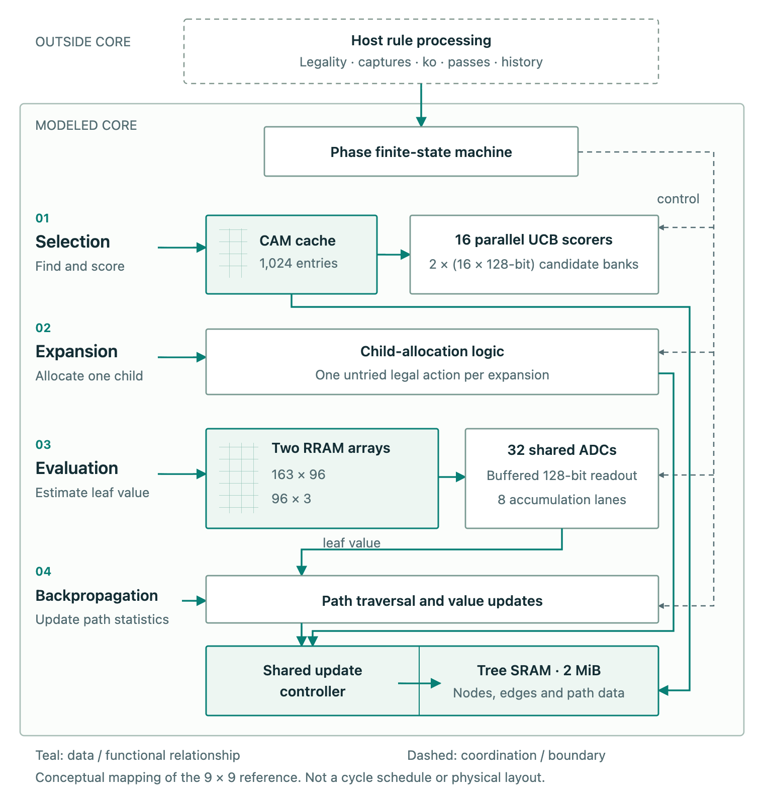

Visual tutorial
===============

How does a search become a sequence of in-memory operations? Follow one MCTS
iteration through the figures below, then connect the search to the hardware
and the quantities reported by the simulator. Click or tap any figure to view it
at full size.

One move, many iterations
-------------------------

A search tree represents possible action sequences. A node represents a state;
an edge represents an action. Repeated visits build evidence about which root
actions are useful.

An **iteration** selects a path, may add one child, evaluates a state and updates
the path statistics. A **move** is selected after the search budget is used. The
current default is an empty 9×9 Go board with Go-strong weights, seed 0 and
**5,000 iterations per move**. That budget is called medium; it is not a measured
playing-strength level.

Walking through one iteration
-----------------------------

We will use a small, abstract tree with three legal root actions: A, B and C.
The decimal values below are illustrative, not a recorded Go trace or a
fixed-point engine replay. The real implementation uses finite-precision values
and scores.

0. Start: read the tree
~~~~~~~~~~~~~~~~~~~~~~~

The root R is Black to move and has 13 visits. Its three legal actions have all
been expanded. Each node stores visits, *n*, and accumulated return, *W*, for the
player to move there. Its children are White to move. C still has an untried
action.

   Starting state. Dashed lines mark an action that has not yet been expanded.

A node's mean return is ``W / n``. Mean returns lie between zero and one, while
accumulated *W* can exceed one. For example, A's stored mean is ``3.20 / 8 = 0.40``
from White's perspective.

1. Select: explore C
~~~~~~~~~~~~~~~~~~~~

The root compares its children using UCB. Because the children are White to move,
Black uses ``Q = 1 - W / n``. Selection adds an exploration bonus to that estimate:

.. raw:: html

   <math display="block" aria-label="UCB score equals Q plus c times the square root of natural log N divided by n">
     <mrow><msub><mi>UCB</mi><mi>i</mi></msub><mo>=</mo>
       <msub><mi>Q</mi><mi>i</mi></msub><mo>+</mo><mi>c</mi>
       <msqrt><mfrac><mrow><mi mathvariant="normal">ln</mi><mi>N</mi></mrow>
         <msub><mi>n</mi><mi>i</mi></msub></mfrac></msqrt>
     </mrow>
   </math>

Here, *N* is the parent's visit count and *n* is the child's visit count. The
exploration constant is *c* = 1.414 in this example and in the default reference.

   Select C. Its single visit produces the largest exploration bonus.

.. list-table:: Selection scores for the starting tree, rounded to three decimals.
   :header-rows: 1
   :widths: 12 14 24 25 25

   * - Child
     - Visits
     - Parent's Q
     - Exploration
     - UCB score
   * - A
     - 8
     - 0.600
     - 0.801
     - 1.401
   * - B
     - 3
     - 0.550
     - 1.307
     - 1.857
   * - C
     - 1
     - 0.400
     - 2.265
     - **2.665**

C has the lowest estimated mean, but its low visit count gives it the highest
selection score. A UCB score can exceed one because it is a selection score,
not a probability.

2. Expand: add D
~~~~~~~~~~~~~~~~

C has been visited and has an untried legal action. Expansion chooses one
remaining legal action and creates child D. D is Black to move and starts with
zero visits and zero accumulated return. The host supplies legal-action handling
for the modeled core.

   Add one child. Existing visit counts and returns have not changed yet.

3. Evaluate: obtain a leaf value
~~~~~~~~~~~~~~~~~~~~~~~~~~~~~~~~

The nonterminal state at D is evaluated by the neural network instead of a random
playout. For this illustration, assume a Black return of **0.75**. This is an
arbitrary teaching value; the figure does not run trained inference.

   Evaluate D. The grid represents neural evaluation; its arrow carries the leaf value.

The raw evaluator output uses Black's perspective. It is also D's own return
here because D is Black to move.

4. Back up: update the path
~~~~~~~~~~~~~~~~~~~~~~~~~~~

D, C and the root each receive one visit. Add 0.75 for Black at D, 0.25 for White
at C, and 0.75 for Black at the root. A and B do not change.

   Update the selected path. Arrow labels show the return added at each ancestor.

C's stored total changes from 0.60 to 0.85, while its parent-view mean becomes
``1 - 0.85 / 2 = 0.575``. A still has eight visits. If the search stopped here,
the reference would choose A as the most-visited root child. **The branch explored
during an iteration need not be the move chosen at the end.**

.. note::

   The very first iteration of a new search evaluates and updates the unvisited
   root before adding a child. Terminal outcomes are supplied by the host; the
   primary model still charges its neural-evaluation service before replacing
   that value with the terminal outcome.

From the tree to the hardware
-----------------------------

The search logic remains dependent on the path and current statistics. IMC-MCTS
maps different operations to complementary primitives:

   Conceptual mapping for the 9×9 reference. Shared memory and control are shown
   once. Connections indicate data dependencies, not cycle durations or routed
   physical wires.

**Selection** accesses cached child information, reads statistics from SRAM and
scores candidates. Sixteen UCB scorers process candidate groups. A CAM lookup
is one service within selection, not a complete tree traversal.

**Expansion and backpropagation** share an update controller. One allocates a
child and its links; the other updates visit counts and returns. Both use the
installed tree memory. The host supplies legal actions and game-rule results.

**Neural evaluation** uses two custom arrays for the 163 → 96 → 3 network. The
163 inputs represent two 81-bit board planes and one player-to-move bit.
Thirty-two shared ADCs, result buffers, a readout bus and eight accumulation
lanes carry values through the modeled readout path.

Parallel resources accelerate work within a phase. They do not mean that the
four phases of one iteration run independently. The simulator schedules their
services, dependencies and resource use explicitly.

Reading latency, energy and power
---------------------------------

The architectural schedule gives a cycle count. Dividing by the assumed clock
frequency gives modeled search latency. Component activity, standby and leakage
contributions give search energy. These are separate from Python execution time.

The retained 9×9 medium Go-strong reference in software version |release| has:

.. list-table:: One complete 5,000-iteration search used to select a move.
   :header-rows: 1
   :widths: 52 48

   * - Quantity
     - Retained reference
   * - Scheduled cycles
     - 27,593,493
   * - Assumed clock
     - 500 MHz
   * - Search latency per move
     - 55.186986 ms
   * - Energy per move
     - 3.703696 mJ
   * - Average core power
     - 67.112 mW
   * - Average energy per iteration within a move
     - 0.7407 µJ

Two calculations make the units explicit:

.. code-block:: text

   average power [mW]
     = 1000 × energy per move [mJ] / latency per move [ms]
     ≈ 1000 × 3.703696 / 55.186986
     ≈ 67.112 mW

   average energy per iteration within a move [µJ]
     = 1000 × energy per move [mJ] / completed iterations
     ≈ 1000 × 3.703696 / 5000
     ≈ 0.7407 µJ

The second quantity is an average across the search. Individual iterations can
follow different paths and incur different services. Neither quantity is the
energy of an entire game.

These numbers come from the
`retained reference ledger <https://github.com/HewlettPackard/IMC-MCTS/blob/c07d5cbb4f2399b5afee6adfe42e23babc8d026b/data/primary/hero.json>`_,
not the toy tree above. They describe a preloaded-core estimate with a 25% ADC
standby allowance. Host rules and history, chip I/O and weight programming are
excluded. See :doc:`model` for the assumptions and validation limits.

Try it in Studio
----------------

The figures above use illustrative values. To inspect the real simulator:

1. Follow :doc:`install` and obtain the approved runtime artifact packet.
2. Use :doc:`usage` to run the default search or start Studio.
3. Inspect the schedule, resources and component assumptions alongside the
   saved results. Keep modeled hardware timing separate from host runtime.

The tutorial and Studio serve different purposes: the figures explain the
mechanism; Studio executes the configured model and reports its recorded work.
