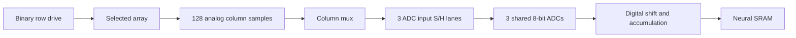

# Shared-ADC readout and column holding

Round 17 added `column_hold_v1` as an explicit architecture candidate.
Round 18 adds separate buffered RTL and executable analog requirements tests.
The default `sustained_drive_v1` describes the existing RTL; its numerical and
cycle-validated source files are preserved.

## What was already present

`NEURAL_RTL_SPEC.md` already says the array stays active during shared
conversion. `imc_neural_sequencer.sv` asserts `array_enable` in ST_DRIVE,
ST_SETTLE, ST_MUX, ST_SAMPLE, ST_ADC_REQ, ST_ADC_WAIT, ST_READOUT and ST_ACCUM.
Thus the old path does not discard column outputs between groups. Its
physical current, conditioning, settling and energy remain uncharacterized.
Calling this a missing logical retention mechanism in Round 16 was too broad.

The three ADC input sample/hold lanes, 24-bit ADC result register, 32-bit
readout bus, signed accumulation registers, and neural SRAM already exist.
The 9x9 neural SRAM partition is 16,512 bytes, including the exponential LUT.
CACTI still prices the same four native 22 nm SRAM macros.

## Candidate dataflow

There is one 128-slot holding bank per physical array, with per-column
current-to-voltage conditioning and capture switches. A 9x9 mapping has
four arrays and 512 installed slots. Only one array/bank is active at a
time. The final-layer array uses 12 of its installed 128 columns. Capture
enables only mapped columns; unused columns still occupy physical area.
Shared mux routing, output buffering and references require circuit design.

For each array, row group and input bit:

1. Drive the selected rows and allow the existing three-cycle settle service.
2. Capture every mapped column in parallel, using one additional assumed cycle.
3. Disable array drive. Keep the samples until their column group is selected.
4. Transfer up to three samples into the existing ADC input S/H lanes. Convert,
   read and shift-accumulate them, then advance to the next column group.
5. Start the next capture only after all groups finish. No pipelining or overlap
   is credited; no ping-pong bank or additional SRAM is assumed.

`ColumnHoldBank` stores continuous values expressed in ADC-code units. It
copies at capture, rejects overwrite while samples remain, checks capacity,
ownership and monotonic time, and consumes each column exactly once. The ADC
rounds only after sampling. The arithmetic uses the same ideal cell mapping,
signed slices, integer activation, SRAM, LUT and probability/value rules as
the existing evaluator. It has no device noise, droop or clipping-error model.

`BufferedNeuralMapping` executes both dot products through these banks. Its
output path is deliberately separate so the preserved implementation remains
a numerical oracle. Tests compare every intermediate with that oracle and
independent integer matrix products. No monkey-patching or parallel estimator
substitutes for the registry's executed inference.

## Timing and physical requirements

| Quantity, one 9x9/H96 inference | Sustained drive | Column holding |
| --- | ---: | ---: |
| Physical arrays | 4 | 4 |
| Installed column holding slots | 0 | 512 |
| Shared ADC input S/H lanes / ADC lanes | 3 / 3 | 3 / 3 |
| Array read bursts | 81 | 81 |
| ADC conversions / groups | 4,800 / 1,611 | 4,800 / 1,611 |
| Additional capture cycles | 0 | 81 |
| Neural cycles, excluding 2 owner cycles | 26,620 | 26,701 |
| Array-enable cycles | 26,067 | 405 |
| Maximum column hold cycles | 0 | 674 |

The assumed 500 MHz clock makes one cycle 2 ns. The added inference time is
162 ns. The last sample in a 128-column bank waits 674 cycles (1,348 ns):
42 preceding full groups at 16 cycles, then one mux and one ADC-input capture
cycle. A 12-column bank requires 50 hold cycles. Times include the one-cycle
ADC request handshake, and hold ends when the ADC input S/H captures the
sample. The existing ADC input S/H must then retain it through conversion.
Stalls increase required hold time; 1,348 ns is the unstalled requirement,
not a guaranteed maximum under arbitrary backpressure.

Array-enable duration is an activity count. It is not a measured current,
conductive energy or energy-saving factor. Zero row bits, off conductance,
front-end bias, sample charging, reference power and wire loading are not
characterized. All analog energy stays unknown. SRAM leakage uses the full
new duration, so the added capture cycles increase reported SRAM energy.

The workbook's C42=85 fF and C41=15 fF/µm² imply a **capacitor-only scenario**
of 5.6667 µm² per slot, or 2,901.3333 µm² for 512 slots. C42 describes an
integrator capacitor, not a characterized holding cell. This scenario is
excluded from the known-area subtotal. No capture-switch/amplifier/routing
or new bank-control area is inferred from it. C40 integrator FET area and
the workbook reference MVM energy are not adopted for this topology.

For a chosen ADC span and error budget, the leakage requirement follows
`I_leak <= C_hold * allowed_voltage_error / hold_time`. Acquisition time,
thermal noise, charge injection, output-drive settling and droop share the
accuracy budget. The workbook read voltage is not an established ADC span.
No value for that span, leakage, ENOB or physical capture time is invented.

## Evidence, identities and limits

The preserved RTL is replayed with an added testbench observation of top-level
array-enable, drive and sample pins. Two inference repetitions confirm 26,067
array-enable cycles, 81 bursts, 1,611 groups and the column hold interval.
That replay validates the **old** controller. The separate Round 18 hardware
package implements capture/disable and ownership control in both neural and
complete-iteration RTL. Its ideal responder stores column codes at capture
and serves ADC inputs from that bank with the array disabled. Directed tests
cover ownership, finite capacity, stalls, errors, reset and reuse. See the
[hardware report](../../p03_experiments/p18_buffered_hardware/README.md) for
retained RTL/gate evidence and the accepted source binding.

The new SPICE sweep checks an ideal RC switch/capacitor/leakage scenario
against independent equations. Its 18 passing cases validate a requirements
model only. Actual current-to-voltage circuitry, switch/ADC models, PVT,
reference/noise/loading and the bounded-stall contract remain unavailable.
Passing digital tests does not establish analog accuracy or physical PPA.

Buffered placement uses `complete_serial_q32_column_hold_v1`; buffered Go uses
`legacy_go_host_rules_q32_column_hold_v1`. Configuration, source hashes,
requested readout, validation scope and saved results keep these distinct.
Go host rules and metadata remain outside billed hardware time. Existing
fixed-budget canonical cases and immutable snapshot files are preserved.

Architecture precedent: Ali Shafiee et al., [ISAAC: A Convolutional Neural
Network Accelerator with In-Situ Analog Arithmetic in Crossbars](https://nlp.cs.utah.edu/assets/pdfs/shafiee2016isaac.pdf),
section V, explicitly places column S/H before a shared ADC. No ISAAC timing
or PPA constants are transplanted. Circuit requirements follow Analog Devices,
[MT-090: Sample-and-Hold Amplifiers](https://www.analog.com/mt-090), especially
the acquisition, switching, droop and hold-error discussion.

Next physical closure: choose and simulate the column conditioning/hold/mux
circuit with actual device models, establish ADC span and error budget,
measure settling/droop and energy over the required retention interval, and
obtain compatible 65 nm digital reports before promoting this candidate.
The driven profile stays the default because physical readout costs do not
yet support an energy winner. Whole-chip PPA remains unavailable until all
missing blocks close.
